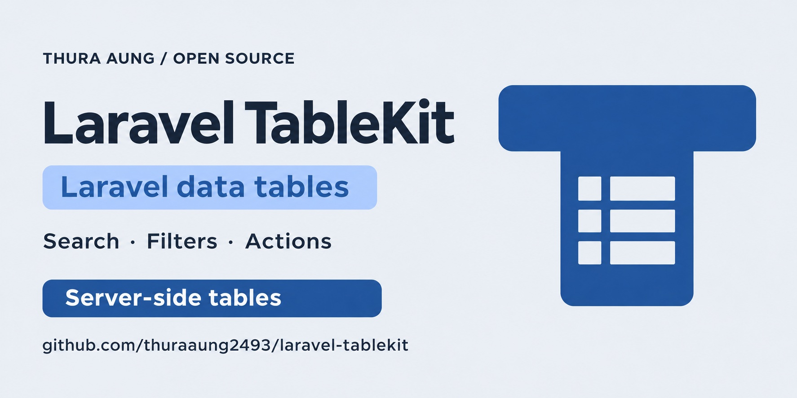

<p align="center">
  
</p>

# Laravel TableKit

Build server-side Laravel tables with an Eloquent query, column definitions,
and one Blade component. TableKit handles search, sorting, pagination,
filters, actions, and current-page selection.



**Start here:** [Create your first table](docs/getting-started.md).

**Browse everything:** [Documentation](docs/README.md).

## Requirements

| Dependency | Supported |
| --- | --- |
| PHP | 7.4+; also meet your Laravel version's requirements |
| Laravel | 7–13 |
| DataTables | 1.10+, 2.x, or 3.x; installed by your application |
| jQuery | Required for DataTables 1.x/2.x; optional for 3.x |

PHP 7.4 and Laravel 7 are end-of-life. Compatibility is retained, but use
maintained versions for production. Exact tested combinations and known
legacy dependency advisories are in [Compatibility](docs/compatibility.md).

## What a table looks like

```php
<?php

namespace App\DataTables;

use App\Models\Client;
use Illuminate\Database\Eloquent\Builder;
use Thuraaung\TableKit\Columns\Column;
use Thuraaung\TableKit\DataTable;

class ClientTable extends DataTable
{
    public function query(): Builder
    {
        return Client::query();
    }

    public function columns(): array
    {
        return [
            Column::make('name')->searchable()->sortable(),
            Column::make('phone'),
        ];
    }
}
```

```blade
<x-tablekit::table
    :table="App\DataTables\ClientTable::class"
    :url="route('clients.data')"
    id="clients-table"
    title="Clients"
/>
```

This short example shows the API. The
[getting started guide](docs/getting-started.md) includes installation,
authentication, routes, frontend files, and the complete page.

## Installation status

The source is available at [github.com/thuraaung2493/laravel-tablekit](https://github.com/thuraaung2493/laravel-tablekit).
The package has not been published to Packagist or npm. Install it using a
Composer VCS or local path repository as shown in the getting started guide.

TableKit never downloads DataTables or jQuery automatically. Your
application chooses one engine and loads the matching TableKit adapter.
See [Frontend setup](docs/frontend.md) for complete commands and script order.

## Guides

| I want to… | Read |
| --- | --- |
| Display my first table | [Getting started](docs/getting-started.md) |
| Choose DataTables or use a bundler | [Frontend setup](docs/frontend.md) |
| Change layout, page size, or defaults | [Configuration](docs/configuration.md) |
| Format cells or display relationships | [Columns and queries](docs/columns.md) |
| Add text, select, or date controls | [Filters](docs/filters.md) |
| Add links, deletion, or bulk operations | [Actions and selection](docs/actions.md) |
| Control a table from JavaScript | [JavaScript API](docs/javascript.md) |
| Protect tables and tenant data | [Authorization and security](docs/security.md) |
| Try the working example | [Demo](docs/demo.md) |
| Fix an installation or loading problem | [Troubleshooting](docs/troubleshooting.md) |
| Run tests or work on the package | [Development](docs/development.md) |

## Included and planned

The MVP includes the core processor, all three frontend adapters, layouts,
filters, authorized actions, selection, generator, and demo. Saved views,
general export integrations, theme adapters, and select-all-filtered
operations are optional future work. See [Implementation status](docs/implementation.md).

License: [MIT](LICENSE).
